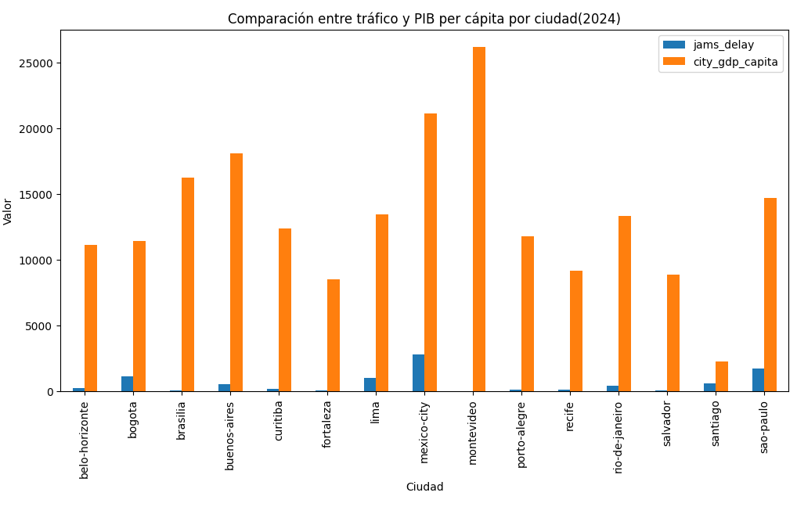
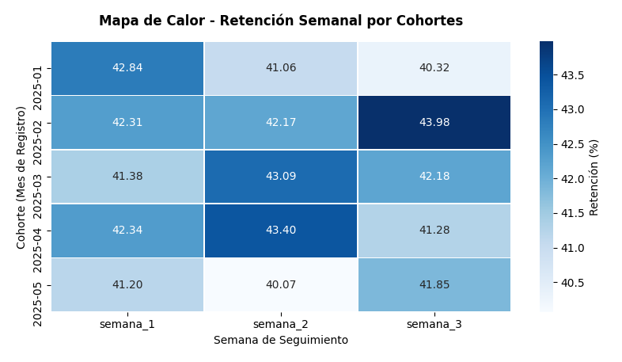
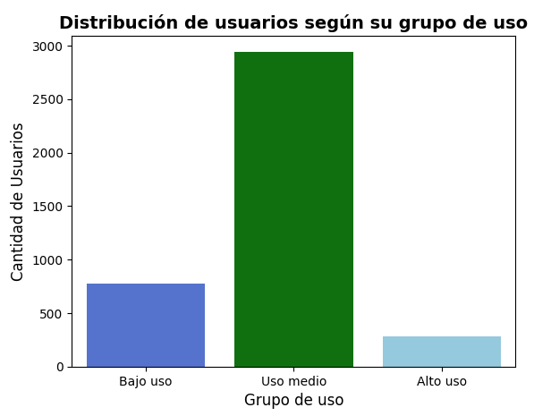

# ¡Hola! Soy Florencia Amigo 👋
### Analista de Datos Jr. | Socióloga | Apasionada por el Data Storytelling y la Visualización

Soy socióloga con formación en análisis de datos, cursando un diplomado en Estadística (UC) y complementándolo con un bootcamp de Data Analyst, especializada en transformar datos complejos en historias claras y accionables para la toma de decisiones estratégicas. Combino el rigor metodológico cuantitativo con un fuerte enfoque de negocio en áreas como **Business Intelligence, Customer Experience y People Analytics**.

---

### 🛠️ Stack Tecnológico y Herramientas

- **Lenguajes y Consultas:** SQL (JOINs, CTEs, subconsultas), Python (Pandas, NumPy), R, DAX.
- **Visualización y Reportería:** Power BI (modelamiento, dashboards ejecutivos y storytelling), Tableau, Excel Avanzado (tablas dinámicas, BUSCARV).
- **Análisis y Metodologías:** Limpieza y modelado de datos, definición de KPIs, análisis de embudos de conversión (*funnels*), análisis de cohorte/retención, pruebas de hipótesis y análisis exploratorio (EDA).
- **Entornos y Control de Versiones:** Jupyter Notebook, Google Colab, SPSS, GitHub.

---

## 🚀 Mis Proyectos Destacados

---

### 1. 🏙️ Movilidad Urbana y Productividad Económica en LATAM (2024)
* **Contexto y Problema:** Simulación analítica para el Banco Interamericano de Desarrollo (BID) para evaluar si el crecimiento económico (PIB per cápita) de 15 metrópolis de América Latina está ligado al colapso vial (`jams_delay`).
* **Hallazgo Principal:** Se demostró un desacople entre la riqueza y el tráfico; ciudades como Montevideo muestran congestión mínima a pesar de su desarrollo, mientras que Ciudad de México o Bogotá combinan economías fuertes con tráfico crítico.

* **Stack:** Python (Pandas, Seaborn, Matplotlib)
* **[🔗 Ver Repositorio Completo](https://github.com/Floaamigo/movilidad-urbana-latam)**

---

### 2. 🚀 Diagnóstico Estratégico Integral: RappiPlus
* **Contexto y Problema:** Auditoría de negocio para evaluar la rentabilidad del servicio de suscripción, detectar dónde se pierden los usuarios en el embudo y medir la retención y el impacto de un cambio de UI.
* **Hallazgos Principales:** 
  - El negocio es altamente rentable (\$2.78M de beneficio neto).
  - La mayor fricción (*drop-off*) ocurre en la pasarela de pagos (`Add_payment_info`).
  - La retención temprana es sólida, manteniéndose estable entre el 40% y el 44% hasta la semana 3.

* **Stack:** Python, SQL, Análisis Financiero, Test A/B (Test Z)
* **[🔗 Ver Repositorio Completo](https://github.com/Floaamigo/diagnostico-estrategico-rappiplus)**

---

### 3. 📊 Diagnóstico y Segmentación de Clientes: ConnectaTel
* **Contexto y Problema:** Análisis de comportamiento de uso (llamadas y mensajes) en operadoras de telecomunicaciones en México y Colombia para optimizar planes y detectar perfiles de consumo.
* **Hallazgos Principales:** 
  - Se segmentó a los usuarios por edad (destacando una gran actividad y lealtad en Adultos Mayores) y por nivel de uso (73.7% en uso medio).
  - Se identificó que los SMS están en desuso, por lo que se recomendó eliminar los "SMS ilimitados" y potenciar planes orientados a datos y voz.

* **Stack:** Python (Pandas, Seaborn), Detección de Outliers, Segmentación
* **[🔗 Ver Repositorio Completo](https://github.com/Floaamigo/analisis-telecomunicaciones-connectatel)**

---

## 🤝 ¿Trabajamos juntos?
Me encuentro en pleno crecimiento laboral y buscando oportunidades para aportar valor en áreas de análisis de negocio y BI. Si tienes una propuesta, una vacante o simplemente te gustaría conversar sobre datos y *storytelling*, ¡escríbeme y hablemos!

* 📧 **Correo:** floamigomartinezz@gmail.com
* 💼 **LinkedIn:** [https://www.linkedin.com/in/florencia-amigo-mar/)]
* 📍 **Ubicación:** Santiago, Chile (Disponible para modalidad híbrida o presencial)
